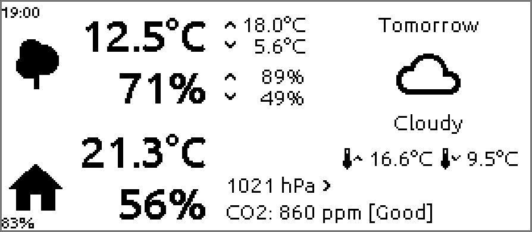

# Home Assistant 2.9" e-paper dashboard

[](https://esphome.io/)
[](packages/dash_xs.yaml)
[](https://www.waveshare.com/wiki/2.9inch_e-Paper_Module_Manual)
[](LICENSE)

A small battery-powered e-paper display for the bedside table or the
hallway: outside and inside temperature and humidity, the last 24 hours'
highs and lows, tomorrow's weather, CO₂ and air pressure — all from
[Home Assistant](https://www.home-assistant.io/). An ESP32-S3 running
[ESPHome](https://esphome.io/) wakes once an hour, draws the page and goes
back to deep sleep, so one charge lasts for weeks. With a 3D-printed case and
its own PCB.

<p align="center"></p>

<p align="center"></p>

## Highlights

- **Outside**: temperature and humidity, each with the highs and lows of the last 24 hours
- **Inside**: temperature and humidity, **CO₂** with *Good* / *Fair* / *Bad*, **air pressure** with a rising/falling/steady arrow
- **Tomorrow**: weather icon, condition (*Partly Cloudy*, *Rainy*, …) and high/low
- **Battery-friendly**: wakes on every full hour, draws once, deep sleep in between — awake for about 10 seconds an hour; **no wakes at night** (last page 23:00, next 6:00)
- **Wake button** for a fresh page at any time
- **Battery** in the corner, with a warning icon below 3.5 V and **one notification** in Home Assistant until it's charged again
- **Never a blank page**: if some values are missing after 40 s, it draws what it has and marks the page with **!**; if Home Assistant can't be reached at all, the last page stays
- **Keep awake** switch in Home Assistant for updates over Wi-Fi; switching it off sends the dash straight back to sleep
- **Wi-Fi signal and wake times** in Home Assistant, to see when wakes get slow
- **Your own sensors**: every Home Assistant entity is a substitution at the top of the config
- E-paper keeps the page without power

## How it works

```
Home Assistant                               dash-xs-esps3 (ESPHome)
sensor.virtual_outdoor_*      ──API──▶       wakes on the full hour (6:00–23:00)
sensor.indoor_* (Netatmo)                    or on the button,
sensor.forecast_next_day  ◀── packages/      waits until every value has arrived,
                              dash_xs.yaml   draws the page, sleeps until the next hour
```

On each wake the device connects with a fixed IP address (no DHCP), waits
until every Home Assistant value has arrived (usually 3 to 6 seconds after
waking), draws the page and sleeps as soon as the panel reports (BUSY line) that the refresh is done. If something is missing after 40 s
it draws anyway, with **!** at the bottom right. Without a connection to
Home Assistant it doesn't draw at all — the last page stays on the screen —
and tries again at the next hour.

The sleep timer runs about 1 % fast, so a wake a few minutes before the hour
counts for that hour (the night's sleep ends around 5:56; that page is the
6:00 one).

## Install

You need Home Assistant with the **ESPHome Device Builder** app (add-on),
the hardware below and a USB-C cable.

| Step | What to do |
|---|---|
| **1. Package** | Turn on packages in `configuration.yaml` (`homeassistant: packages: !include_dir_named packages`), copy [`packages/dash_xs.yaml`](packages/dash_xs.yaml) to `/config/packages/`, set your notifier in the low-battery automation, check the configuration and reload *All YAML configuration*. It needs a `weather.forecast_home` entity (the Met.no integration makes one). |
| **2. Secrets** | Copy the keys from [`esphome/secrets.example.yaml`](esphome/secrets.example.yaml) into `/config/esphome/secrets.yaml` and fill them in — including a fixed IP address, which you also reserve on your router. |
| **3. Config** | Copy [`esphome/dash-xs-esps3.yaml`](esphome/dash-xs-esps3.yaml) and the [`fonts/`](esphome/fonts) folder into `/config/esphome/`. Point the substitutions at the top to your own sensors. |
| **4. Flash** | In the ESPHome Device Builder: *dash-xs-esps3 → Install → Plug into this computer* the first time, over Wi-Fi after that. |
| **5. Adopt** | The device shows up under *Settings → Devices & services*. |

**Updating over Wi-Fi**: turn on **Dash XS keep awake**
(`input_boolean.dash_xs_keep_awake`), press the wake button (or wait for the
full hour), install, then turn *Keep awake* off again — the dash goes back to
sleep at once. Uploads are encrypted with the API key.

## What's on the page

| Where | What | Entity (substitution) |
|---|---|---|
| top left | time of this page | Home Assistant time |
| left, tree icon | outside temperature, 24 h high/low | `outdoor_temperature`, `outdoor_temperature_max`, `outdoor_temperature_min` |
| | outside humidity, 24 h high/low | `outdoor_humidity`, `outdoor_humidity_max`, `outdoor_humidity_min` |
| left, house icon | inside temperature and humidity | `indoor_temperature`, `indoor_humidity` |
| right | *Tomorrow*: icon, condition, high/low | `forecast_next_day` (from the package) |
| bottom middle | air pressure with trend arrow | `indoor_pressure`, `indoor_pressure_trend` (`up` / `down` / `stable`) |
| | CO₂ — *Good* below 1000 ppm, *Fair* up to 1200, *Bad* above (`co2_fair`, `co2_bad`) | `indoor_co2` |
| bottom left | battery %, warning icon below 3.5 V | measured on the device |
| bottom right | **!** when some values didn't arrive in time | |

## Home Assistant entities

**From the package**:

| Entity | What it is |
|---|---|
| `sensor.forecast_next_day` | tomorrow's condition (state); attributes `condition`, `temperature`, `templow`, `cloud_coverage`, `datetime` — from `weather.forecast_home`, every 30 minutes |
| `input_boolean.dash_xs_keep_awake` | on = the dash doesn't go to sleep (for updates over Wi-Fi); off by default |
| `automation.dash_xs_low_battery` | *Dash XS – Low battery alert* — one notification when the battery is below 3.5 V; after charging above 3.9 V it's armed again |
| `input_boolean.dash_xs_battery_alerted` | on once the alert has been sent, off again after charging |

**From the device** (*Dash XS*): `sensor.dash_xs_battery_voltage` (V),
`sensor.dash_xs_battery_level` (%), `sensor.dash_xs_wi_fi_signal` (dBm), `sensor.dash_xs_wake_connected_after`
and `sensor.dash_xs_wake_total` (seconds per wake, sent right before sleep), `light.dash_xs_rgb_led` (the board's LED),
`button.dash_xs_restart_esp`.

## Battery

Deep sleep between the hourly wakes and short wakes keep the drain low: in
October 2026 the battery dropped from 4.11 V to 4.03 V (about 85 %) in a week.
The voltage is read on GPIO1 through a divider; the percentage follows a LiPo
curve (3.30 V = 0 %, 3.68 V = 10 %, 3.82 V = 50 %, 4.20 V = 100 %).

## Hardware

| | |
|---|---|
| Board | ESP32-S3 (ESPHome board `esp32-s3-devkitc-1`), WS2812 LED on GPIO48 |
| Display | Waveshare 2.9" e-paper V2, 296×128 (`2.90inv2-r2`), landscape — SPI: CLK GPIO10, DIN GPIO7, CS GPIO6, DC GPIO9, BUSY GPIO5, RST GPIO8 |
| Button | GPIO2 to ground, wakes the device |
| Battery | LiPo, voltage on GPIO1 through a divider (factor 3.327, calibrated) |
| PCB | schematic, Gerber and EasyEDA files in [`PCB/`](PCB) — drawn for the first version with an ESP32-C3; the ESP32-S3 version uses the same GPIOs |

## Repository layout

```
esphome/
  dash-xs-esps3.yaml        # device config: page, wake cycle, deep sleep, sensors
  secrets.example.yaml
  fonts/                    # Ubuntu Medium, Material Design Icons
packages/
  dash_xs.yaml              # tomorrow's forecast, keep awake, low-battery notification
tools/
  render_preview.py         # draws docs/preview.png from the page layout
docs/
  preview.png
PCB/                        # schematic, Gerber, EasyEDA project
3D Files/                   # case
```

## Development

`main` holds released versions, `dev` is where work happens. Changes go to
`dev`, are tested on the real device and merged to `main` with a release.
Every change gets an entry in [CHANGELOG.md](CHANGELOG.md). Validate the
config without a device:

```bash
esphome config esphome/dash-xs-esps3.yaml
```

After a layout change, update `tools/render_preview.py` to match and redraw
the preview (needs Pillow):

```bash
python tools/render_preview.py
```

## License

[MIT](LICENSE). Ubuntu font under the Ubuntu Font Licence, Material Design
Icons under the Apache License 2.0.
